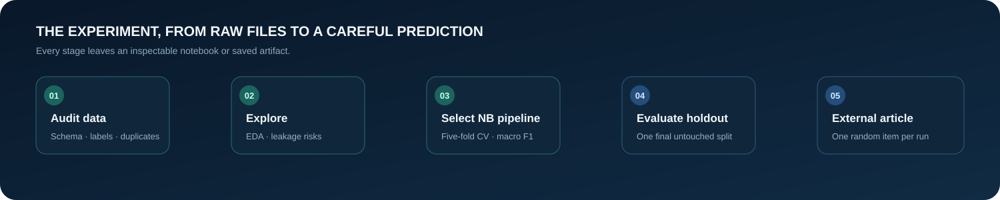

<div align="center">
  
  <br><br>
  
  
  
  
  <br><br>
  <a href="#quick-start">Quick start</a> ·
  <a href="#notebook-guide">Explore notebooks</a> ·
  <a href="#recorded-results">View results</a> ·
  <a href="#interpretation-and-limitations">Read limitations</a>
</div>

<br>

> [!WARNING]
> **This is a text classifier, not a fact-checker.** It predicts labels from language patterns in its training data. It does not verify claims against evidence. Never use a prediction as the sole basis for judging or sharing a news story.

<details>
<summary><strong>Contents</strong></summary>

- [Project overview](#project-overview)
- [Workflow at a glance](#workflow-at-a-glance)
- [Quick start](#quick-start)
- [Notebook guide](#notebook-guide)
- [Data](#data)
- [Modeling decisions](#modeling-decisions)
- [Recorded results](#recorded-results)
- [Project structure](#project-structure)
- [Interpretation and limitations](#interpretation-and-limitations)
- [Reproducibility notes](#reproducibility-notes)
- [Attribution](#attribution)

</details>

## Project overview

The project builds and evaluates a binary text classifier using **Naive Bayes only**. The trained pipeline uses article title and body text; it excludes fields such as subject, date, and source metadata.

The workflow separates model selection from final evaluation:

1. The training portion is used for a fixed five-fold cross-validation search.
2. The selected pipeline is evaluated once on a reserved random holdout.
3. A separate external sample provides a narrow transfer check.
4. `Model_Test.ipynb` is an interactive demonstration that selects and classifies **one random external article each time its classification cell runs**.

## Workflow at a glance

<p align="center">
  
</p>

## Quick start

### 1. Place the original data

Keep the two source files here:

```text
data/raw/News/Fake.csv
data/raw/News/True.csv
```

They must contain at least `title` and `text` columns. The audit and visualization notebooks also inspect `subject` and `date` when present. Labels are assigned from the source file: `Fake.csv` → `fake`, `True.csv` → `real`.

### 2. Create an environment and install dependencies

PowerShell on Windows:

```powershell
py -3.13 -m venv .venv
.\.venv\Scripts\Activate.ps1
python -m pip install --upgrade pip
python -m pip install -r requirements.txt
python -m pip install notebook
jupyter notebook
```

Open notebooks from the project root or select the project `.venv` kernel. The notebooks locate the repository by searching for `data/raw/News` in the current folder and its parents.

### 3. Run notebooks in order

Run each notebook from top to bottom. Notebooks 3 and 4 produce the artifacts required by the later model test. The `Model_Test` notebook only loads the final saved model; it does not train or tune it.

## Notebook guide

| Order | Notebook | Purpose | Main outputs |
|---|---|---|---|
| 1 | [`01_data_overview.ipynb`](notebooks/01_data_overview.ipynb) | Checks schema, labels, blanks, duplicates, date coverage, and data risks. | Dataset audit and modeling guardrails. |
| 2 | [`02_data_visualization.ipynb`](notebooks/02_data_visualization.ipynb) | Visualizes class balance, subject/label relationships, text lengths, duplicates, and date coverage. | EDA findings used to choose safe model inputs. |
| 3 | [`03_model_building.ipynb`](notebooks/03_model_building.ipynb) | Removes exact title/body duplicates, creates a stratified 80/20 split, runs the baseline and controlled 5-fold NB search, and fits the selected pipeline on the training portion. | `models/final_naive_bayes_pipeline.joblib`, `outputs/experiment_log.csv`, `outputs/holdout_article_ids.csv`. |
| 4 | [`04_holdout_evaluation.ipynb`](notebooks/04_holdout_evaluation.ipynb) | Scores the frozen pipeline once on the reserved holdout; reports metrics, class errors, and a confusion matrix. | `outputs/holdout_metrics.json`, `outputs/holdout_predictions.csv`. |
| Demo | [`Model_Test.ipynb`](notebooks/Model_Test.ipynb) | Randomly selects one article from the external sample and shows its dataset label beside the model prediction. Rerun the classification cell for another article. | `outputs/external_test/single_article_prediction.csv` (latest result only). |

### Using `Model_Test` one article at a time

1. Run the setup cell to load the external data and saved pipeline.
2. Run **“Randomly select and classify one article.”** The notebook chooses one row at random and displays a table with its title, actual label, predicted label, and whether they match.
3. Rerun that cell to select another article.
4. Run the save cell when you want to write the current result. It overwrites the one-row output file with the latest selection.

Each prediction applies the saved text pipeline to `title + "\n\n" + text`. The actual label is displayed for comparison, but is never passed into the model.

## Data

### Primary training and holdout data

`data/raw/News/Fake.csv` and `data/raw/News/True.csv` form the project corpus. Notebook 1 recorded 44,898 raw rows: 23,481 labeled fake and 21,417 labeled real. Notebook 3 removes exact duplicate title/body records before splitting, leaving 39,105 unique articles. It also checks that identical content does not appear under conflicting labels.

### External sample

[`data/external/Test_News/external_test_news.csv`](data/external/Test_News/external_test_news.csv) contains 95 cached English-language COVID-19 articles from CrossFake: 20 fake and 75 real. It includes full text and provenance links, so evaluating it does not depend on source pages remaining available. The sample contains article-type, non-mixed records and has no exact normalized title/body overlap with the project’s original corpus.

See [`data/external/Test_News/README.md`](data/external/Test_News/README.md) and its included license for dataset selection, label meaning, and attribution. These are inherited CrossFake labels, not new fact-checks performed by this project.

## Modeling decisions

- **Algorithm family:** MultinomialNB and ComplementNB; no non-Naive-Bayes estimator is considered.
- **Text input:** title and body concatenated. `subject`, `date`, and filename/source metadata are excluded because EDA found strong label/source associations.
- **Duplicate handling:** exact `(title, text)` duplicates are removed before splitting; contradictory labels for identical content stop the workflow.
- **Split:** stratified 80/20 train/holdout using seed 42. The holdout is not used during selection.
- **Selection metric:** mean 5-fold validation macro F1. Accuracy and macro precision/recall are secondary context.
- **Search:** 48 predeclared unigram configurations across BoW/TF-IDF, `min_df` 2/5, both NB variants, and six `alpha` values. The feature matrices are reused across applicable classifiers. Bigrams were excluded after the earlier search exceeded the time budget.
- **Final artifact:** the selected vectorizer and classifier are saved together as one scikit-learn pipeline.

## Recorded results

Results below are from the saved experiment logs and evaluation outputs. They describe this dataset and these splits only.

| Evaluation | Macro F1 | Accuracy | Notes |
|---|---:|---:|---|
| Best 5-fold CV | 0.95609 | 0.95637 | BoW unigrams, `min_df=2`, ComplementNB, `alpha=0.01`. |
| Baseline 5-fold CV | 0.95356 | 0.95387 | BoW unigrams, MultinomialNB, `alpha=1`. |
| Reserved holdout | 0.95534 | 0.95563 | 7,821 articles; 347 errors. |
| External CrossFake sample | 0.77700 | 0.83158 | 95 articles; 20 fake and 75 real; balanced accuracy 0.82000. |

The two strongest CV configurations (ComplementNB and MultinomialNB with BoW, `min_df=2`, `alpha=0.01`) were effectively tied. The holdout score is close to CV, while the lower external macro F1 signals weaker transfer to the COVID-19 sample. On that external sample, the confusion matrix was: 16 fake articles predicted fake, 4 fake articles predicted real, 12 real articles predicted fake, and 63 real articles predicted real. This means fake recall was 0.80 and real recall was 0.84; the error counts are consistent with the saved 20-fake/75-real label distribution.

The external aggregate score and confusion counts are a saved batch-evaluation snapshot from before `Model_Test.ipynb` was changed to select one article per run. The current demo does not recompute aggregate external metrics; it shows and optionally saves the latest single prediction. Full records are in [`outputs/experiment_log.csv`](outputs/experiment_log.csv), [`outputs/holdout_metrics.json`](outputs/holdout_metrics.json), and [`outputs/external_test/external_test_metrics.json`](outputs/external_test/external_test_metrics.json), when those outputs are present.

## Project structure

```text
.
├── configs/
│   └── config.yaml
├── data/
│   ├── raw/News/                  # Fake.csv and True.csv
│   └── external/Test_News/        # Cached CrossFake test sample + attribution
├── models/
│   └── final_naive_bayes_pipeline.joblib
├── notebooks/
│   ├── 01_data_overview.ipynb
│   ├── 02_data_visualization.ipynb
│   ├── 03_model_building.ipynb
│   ├── 04_holdout_evaluation.ipynb
│   └── Model_Test.ipynb
├── outputs/
│   ├── experiment_log.csv
│   ├── holdout_article_ids.csv
│   ├── holdout_metrics.json
│   ├── holdout_predictions.csv
│   └── external_test/
└── requirements.txt
```

## Interpretation and limitations

- The model predicts the dataset’s `fake`/`real` label from text. It does **not** retrieve evidence, verify claims, or determine truth.
- The primary labels are inherited from the source CSV files. A source-file label is not equivalent to independent article-by-article fact-checking.
- Notebook 2 found that subject categories aligned strongly with labels. Although subject and date are excluded, article wording may still reveal publisher, topic, or time-period patterns.
- The random holdout comes from the same corpus and labeling process as training. It estimates performance on that distribution, not on future events or unseen publishers.
- The external set is small, imbalanced, COVID-19-focused, and historical. Its performance is a useful warning about transfer limits, not a representative real-world benchmark.
- False-real and false-fake errors both occur. Do not use the prediction as the sole basis for sharing, suppressing, or judging a news story.

A stronger real-world assessment would require a larger, recent, time-separated sample from independent publishers, with carefully verified labels and rights to use the text.

## Reproducibility notes

- Notebook seed: **42** for train/holdout and cross-validation splits.
- The external one-article selection is intentionally random and can differ on each run.
- The final holdout should remain reserved. Do not tune the model using holdout results and then report the same holdout as an untouched final test.
- The saved pipeline was created with Python 3.13.3 and scikit-learn 1.9.1. Load serialized scikit-learn models in a compatible environment.
- The raw primary corpus is expected under `data/raw/News`; the notebooks do not download it.

## Attribution

The external sample comes from [CrossFake](https://github.com/YingtongDou/CrossFake), described in Du et al., “Cross-lingual COVID-19 Fake News Detection” (ICDMW 2021). Its Apache-2.0 license and sample-specific notes are included in [`data/external/Test_News/`](data/external/Test_News/).

